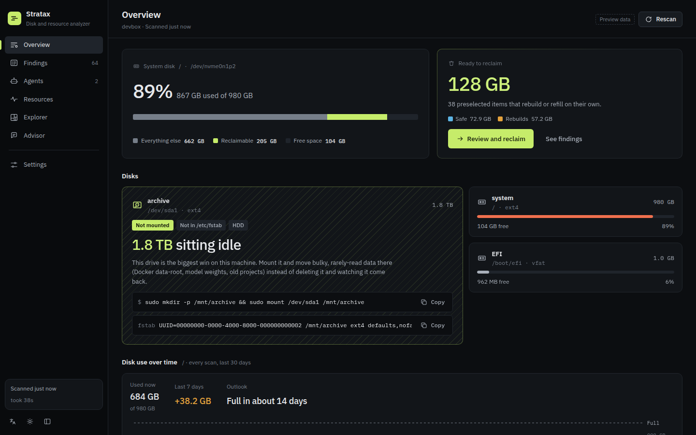
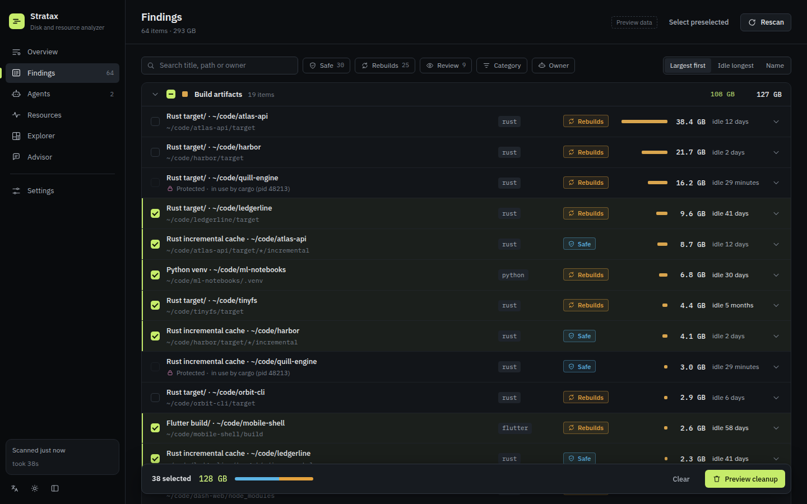
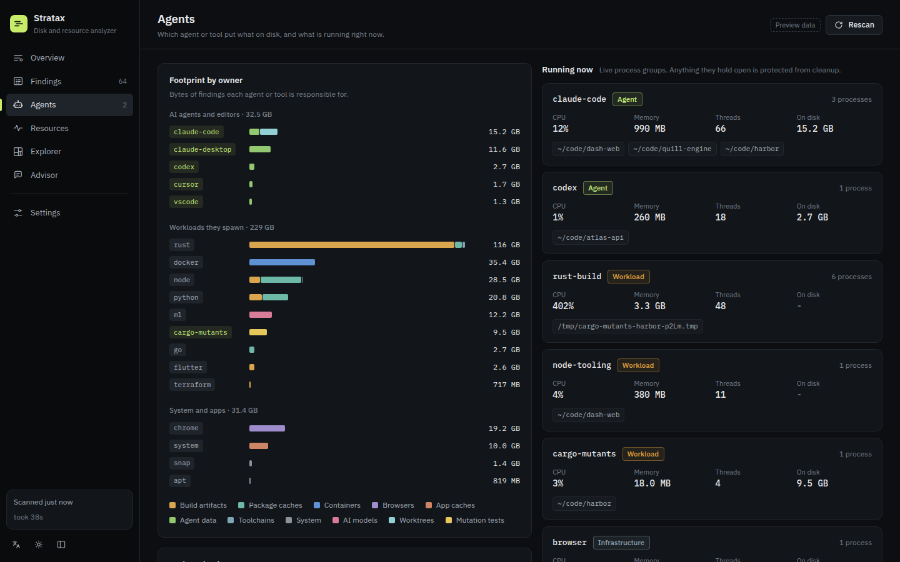
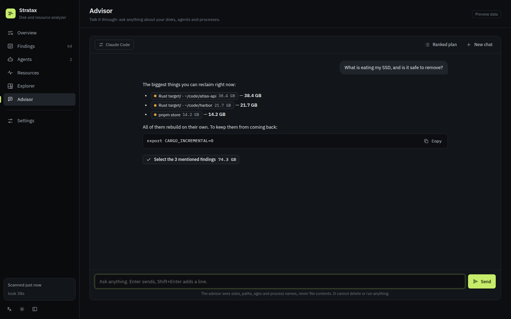
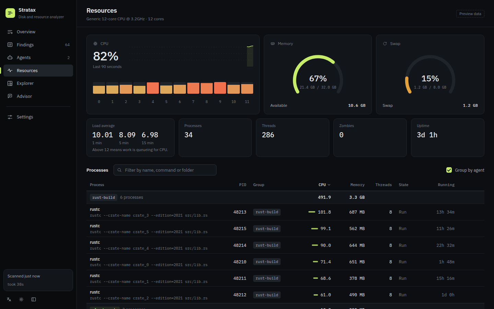
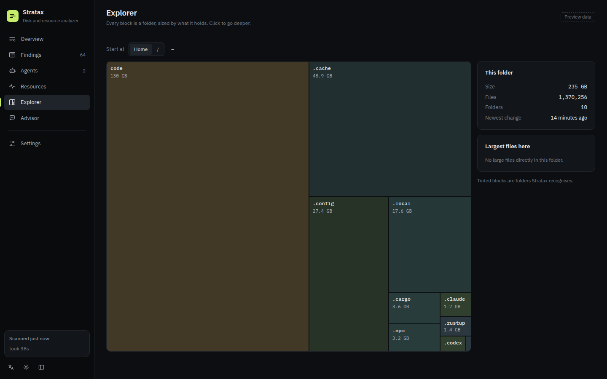
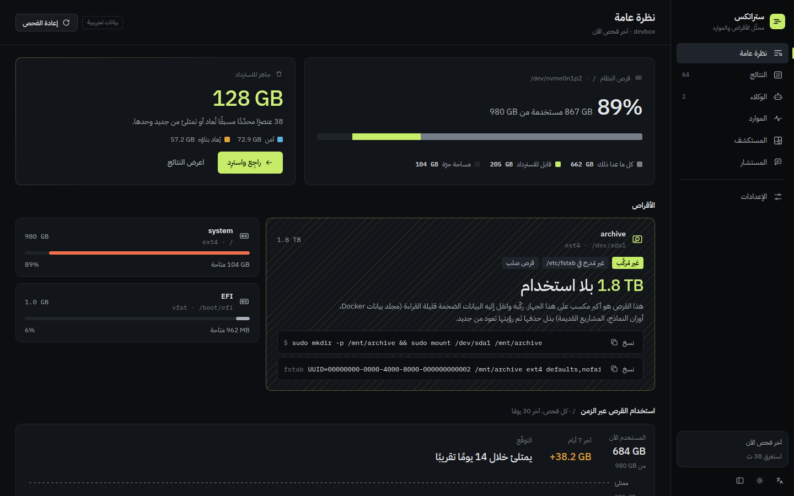

# Stratax

<p>
  <a href="https://github.com/ta9in-oss/stratax/actions/workflows/ci.yml"></a>
  <a href="https://github.com/ta9in-oss/stratax/releases/latest"></a>
  <a href="LICENSE"></a>
  
  
  
  
  
  <a href="https://github.com/ta9in-oss/stratax/commits/main"></a>
</p>

Disk and resource analyzer for machines where **many AI coding agents work on many projects at once**.
It knows where Claude Code, Codex and Cursor leave data, what mutation testers (cargo-mutants, Stryker,
mutmut) copy into temp dirs, which build outputs regrow, and which of it is safe to reclaim **right now**
— without touching anything a live agent is using.

Three front ends share one Rust core:

| | |
|---|---|
| `stratax` | TUI (default) — overview, findings, agents, resources, explorer, advisor |
| `stratax scan/status/advise/clean --json` | non-interactive, for scripts **and for agents** |
| `stratax-desktop` | Tauri 2 app, English + Arabic (RTL) |

<p align="center"></p>

<table>
  <tr>
    <td></td>
    <td></td>
  </tr>
  <tr>
    <td></td>
    <td></td>
  </tr>
  <tr>
    <td></td>
    <td></td>
  </tr>
</table>

<sub>Screenshots use synthetic sample data from an invented machine.</sub>

## What it finds

- **Agent leftovers** — Claude Code session scratchpads in `/tmp/claude-<uid>/<project>/<session>`
  (protected while that project has a live `claude` or was touched < 2 h ago), transcripts, file history,
  Claude desktop VM bundles, Codex runtimes/sessions/worktrees, Cursor/VS Code workspace storage.
- **Mutation testing** — orphaned `$TMPDIR/cargo-mutants-*` copies, `mutants.out(.old)`, `.stryker-tmp`,
  mutmut caches. Live runs are detected from the process table and protected.
- **Build artifacts** — Rust `target/` (with a separate, always-safe `incremental/` finding), `node_modules`,
  `.next`, `.turbo`, venvs, Gradle/Flutter/CMake builds, Terraform, agent worktrees (`.claude/worktrees`).
- **Caches & toolchains** — pip, uv, yarn, npm, pnpm, bun, go, cargo, Playwright/Puppeteer browsers, rustup,
  pyenv, nvm, every other `~/.cache/*`.
- **Docker, snaps, APT** — handed off to their own tools (`docker builder prune`, `snap remove --revision`…).
- **Disks** — every partition incl. unmounted ones, and whether it mounts at boot (`/etc/fstab`).

Each finding gets a label — **safe** (pure cache), **rebuild** (comes back after a build/install),
**review** (may hold data) — and is preselected only when safe ≥ 2 days idle, rebuild ≥ 3 weeks idle,
or a download cache.

## Safety model

1. **Guards** — any path a process has as its cwd or holds open (`/proc/*/fd`) is locked. Worktrees with
   uncommitted changes or commits on no branch are locked. Guards run again right before every action.
2. **Allow-list** — only paths under `$HOME`, `/tmp`, `/var/tmp`; never their roots, top-level folders,
   or git repository roots. `sudo` actions are printed for you to run, never executed.
3. **Dry run first** — every UI previews; the CLI only acts with `--yes`. All actions are logged to
   `~/.local/share/stratax/operations.log`.
4. **The AI never deletes** — it receives sizes, ages, labels and finding ids, and answers with ids.
   Unknown or protected ids are dropped.
5. **Gentle scanning** — walks run on half the cores at nice 10 and the lowest best-effort I/O priority (`--turbo` for full
   speed). Peak RSS of a full scan here: ~35 MB.

## AI advisor

| Provider | How | Config |
|---|---|---|
| Claude Code (default) | `claude -p`, uses your Claude Code login | — |
| Anthropic API | Messages API, `claude-opus-5-5`, structured JSON output, server-side refusal fallback | `ANTHROPIC_API_KEY` |
| Agnes | OpenAI-compatible `https://apihub.agnes-ai.com/v1`, `agnes-2.5-pro-alpha` | `AGNES_API_KEY` |
| OpenAI-compatible | any `/chat/completions` endpoint | `~/.config/stratax/advisor.json` |
| Offline | deterministic rules | — |

`stratax advise --provider agnes`, or `STRATAX_PROVIDER` / `STRATAX_MODEL`.

**Chat.** The Advisor view (and `stratax chat`, or `stratax chat "question"` for one shot) is a free
conversation in English or Arabic. Replies stream. Each turn sees the latest scan plus a live CPU, memory and
process snapshot, and mentioned findings become links you can select. The ranked plan is one button
inside the conversation. Chat follows the same rule as the plan: no tools, it can't run or delete anything.
`claude -p` runs from Stratax's data folder with `--setting-sources project`, so your user plugins, hooks
and output styles don't leak into replies.

## Install

Prebuilt binaries are on the [releases page](https://github.com/ta9in-oss/stratax/releases/latest):

| | |
|---|---|
| CLI + TUI | `stratax-<target>.tar.gz` for Linux (x86_64, aarch64) and macOS (Apple Silicon, Intel) |
| Desktop | `.deb` and `.AppImage` for Linux x86_64 |

```bash
# CLI, e.g. Linux x86_64
curl -L https://github.com/ta9in-oss/stratax/releases/latest/download/stratax-x86_64-unknown-linux-gnu.tar.gz | tar xz
./stratax-x86_64-unknown-linux-gnu/stratax

# Desktop on Debian/Ubuntu
sudo apt install ./Stratax_<version>_amd64.deb
```

Each file has a `.sha256` next to it.

## Build

```bash
cargo build --release -p stratax          # CLI + TUI
./target/release/stratax                  # TUI
./target/release/stratax scan             # report
./target/release/stratax clean --preselected        # dry run
./target/release/stratax clean --preselected --yes  # do it
```

Desktop (Tauri 2):

```bash
sudo apt install libwebkit2gtk-4.1-dev librsvg2-dev   # once
cargo tauri build -c crates/stratax-desktop/tauri.conf.json   # or: cargo run -p stratax-desktop
```

On a machine without `sudo`, `scripts/devlibs.sh` builds a local pkg-config shim over the WebKitGTK
**runtime** libraries in `.devlibs/` (the gtk-rs `-sys` crates only need pkg-config metadata and an
unversioned `.so`). To use it, set `PKG_CONFIG_PATH=$PWD/.devlibs/pkgconfig` for the build.

The UI in `ui/` is plain HTML/CSS/JS. Open it in a browser without Tauri and it runs on the sample data
in `ui/mock/`.

## Data

`~/.local/share/stratax/` — `last-report.json` (the UIs open on it; the desktop app rescans on launch
only when it is older than 30 minutes), `history.jsonl` (30 days of per-scan disk use: the Overview trend,
growth and "days until full"), `operations.log`.

**Move to HDD** is offered only for disks listed in `/etc/fstab`, so a moved folder can't turn into a
dangling symlink after a reboot. The move copies to `<dest>.partial`, renames it into place, swaps the
original aside, links, and only then deletes. An interruption leaves either the original or a complete copy.

`ui/mock/*.json` hold synthetic sample data for the browser preview and the screenshots in
`docs/screenshots/`: an invented machine (`devbox`, user `dev`, made-up projects). Regenerate them with
`python3 scripts/gen_mock.py`.

## Platforms

Linux is fully supported. Everything OS-specific sits behind `platform::Platform`. Other systems fall back
to a `sysinfo`-based backend, which is degraded: no fd guards and no unmounted-disk detection.

## License

[MIT](LICENSE)
